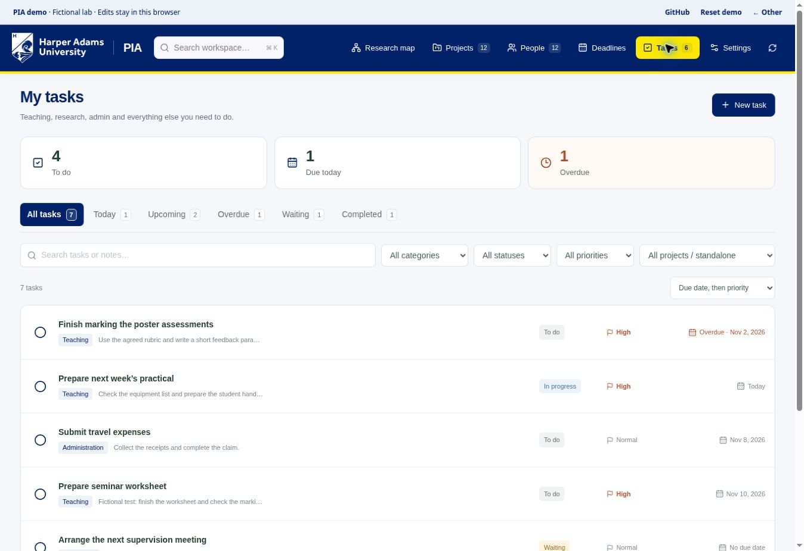

# PIA: research and personal tasks

**Joe Roberts's personal version of Principal Investigator's Assistant.** Manage research projects alongside teaching, marking, supervision, administration and everyday tasks. A task can stand alone; it does not need to belong to a project.

This fork adapts [Assaf Shocher's PIA](https://github.com/assafshocher/PIA) with a personal task tracker and Harper Adams navy, yellow and the university logo. It is a personal workspace, with no institutional endorsement or university single sign-on implied. See the [branding sources](docs/branding.md).



[Set up in your browser](#set-up-in-your-browser) · [Task guide](docs/personal-tasks.md) · [Security](SECURITY.md) · [Advanced deployment](docs/deployment.md) · [Developer setup](#developer-setup)

## What this version does

| Area | What you can do |
| --- | --- |
| Personal tasks | Create a task with just a title. Optionally add a category, due date, priority, notes or project link. |
| Workload views | See Today, Upcoming, Overdue, Waiting, Completed or All tasks. Search, filter, complete, reopen, archive and restore tasks. |
| Research | Connect people, projects and deadlines; retain project updates, submission history, links and private attachments. |
| Backups | Export and import records, including tasks. Attachment files need a separate backup. |
| Optional AI connection | Authorise a compatible assistant to read or update the same workspace through MCP. The app also works without AI. |

Task dates use UK time, including daylight saving. Due dates do not send notifications; recurring tasks and calendar synchronisation are not included.

## Set up in your browser

**You do not need to install Node.js, Git or any other software on your computer.** Use GitHub and Cloudflare in your web browser. Cloudflare runs the build and deployment commands for you.

You need your GitHub account, a Cloudflare account and a password manager to generate and save two different random passwords. Cloudflare may ask you to enable storage services or supply billing details; check its displayed terms before proceeding. Creating a repository alone does not create a running app.

### 1. Put the customised version on the main branch

Open [pull request #1](https://github.com/Dr-Joe-Roberts/pia/pull/1). If it is still open, select **Merge pull request → Confirm merge**. If GitHub already marks it **Merged**, continue to step 2.

This puts the task tracker, HAU branding and these instructions on `main`, the version used by the deployment button below.

### 2. Create your Cloudflare app

Use this button, which points to **Dr-Joe-Roberts/pia**:

[](https://deploy.workers.cloudflare.com/?url=https://github.com/Dr-Joe-Roberts/pia)

Sign in to Cloudflare and connect GitHub when prompted. Choose an available name, such as `joe-pia`. The flow creates a new deployment repository in your GitHub account and provisions the app's database, attachment storage and OAuth storage. Keep the binding names `DB`, `BUCKET` and `OAUTH_KV` unchanged.

**Save the address of the new repository.** It becomes the source for this deployment; later edits to the original `pia` fork do not automatically appear in that separate copy.

### 3. Check the build settings and deploy

Confirm these values in the Cloudflare form:

| Cloudflare field | Value |
| --- | --- |
| Build command | `npm run build` |
| Deploy command | `npm run deploy` |

These are entries in a website form, not commands to run on your computer. The deploy command also prepares the database tables. Use the full Worker app for private hosting; the static demo is a separate preview.

If the form asks for `OWNER_PASSWORD`, `SESSION_SECRET` or `APP_ORIGIN` now, use the explanations in step 4. If the app address is not yet known, enter `https://setup.invalid` for `APP_ORIGIN` temporarily. Keep `DEMO_MODE` set to `false` if shown.

Select **Deploy**. After it finishes, copy the app's HTTPS address from Cloudflare. An initial configuration error is expected while `APP_ORIGIN` still contains the temporary value; complete step 4 to unlock the app.

### 4. Set up your private login

There are three settings: your sign-in password, a separate secret used internally by the app, and the app's web address. **Only `OWNER_PASSWORD` is used to sign in.**

In the [Cloudflare dashboard](https://dash.cloudflare.com/), open **Workers & Pages → your app → Settings → Variables and Secrets**. These are the Worker's settings, not the build environment settings.

Select **Add** for a missing setting, or **Edit** if it already exists. Enter the following names exactly, one setting at a time:

| Variable name | Value to enter | Type |
| --- | --- | --- |
| `OWNER_PASSWORD` | A unique random password of **at least 20 characters**, generated and saved in your password manager. This is your PIA sign-in password, separate from your GitHub, Cloudflare and HAU passwords. | **Secret** |
| `SESSION_SECRET` | A **second, different random value**, preferably **64 characters**, generated and saved in your password manager. The app uses it to protect login sessions. | **Secret** |
| `APP_ORIGIN` | The exact HTTPS app address supplied by Cloudflare, with no final slash or page path. Replace `https://setup.invalid` if you used it earlier. | **Secret** |

The app address is not confidential, but storing `APP_ORIGIN` as a Secret also works and matches the deployment form's secret prompts. A Text value works too; see the [deployment guide](docs/deployment.md#configuration-values) for preserving it across future deployments. Do not add a second entry with the same name.

For example, **if** Cloudflare gives you the address below, use that whole line as `APP_ORIGIN`:

```text
https://joe-pia.example.workers.dev
```

This is an example, not your live address. Use yours, without `/login`, `/lab`, `/mcp` or a trailing `/`. Paste the value only, without quotation marks.

Leave `DEMO_MODE` as `false` if it exists; it may also be absent. Select **Deploy** to apply the settings. Enter both generated passwords directly into Cloudflare and retain them in your password manager; do not put them in GitHub files, screenshots or chat.

Cloudflare's [dashboard instructions for secrets](https://developers.cloudflare.com/workers/configuration/secrets/#via-the-dashboard) describe the same controls.

### 5. Sign in and check the app

1. Open your app's address and sign in using **`OWNER_PASSWORD`**.
2. Select **Tasks → New task**, enter a fictional example such as “Prepare a teaching session”, choose **Teaching**, and select **Create task**. Leave the project field empty.
3. Refresh the page and confirm that the task remains. Complete or archive it when finished.
4. In a private/incognito browser window, open your app at `/lab`. It should require sign-in. Opening `/api/records?kind=task` or `/api/export` in that signed-out window should return a sign-in error and no private records.

Before entering real student or institutional information, confirm that this hosting arrangement is acceptable under HAU's data policies.

## If setup does not work

| What you see | What to check |
| --- | --- |
| “Setup required”, or a configuration error before login | All three settings in step 4 are present on the Worker, the values meet the stated lengths, and you selected Deploy after saving. |
| “Open the configured APP_ORIGIN” | Replace the temporary address with the exact HTTPS address you are visiting. Remove any trailing slash or page path, then Deploy. |
| Your password is rejected | Use the value of `OWNER_PASSWORD`, not `SESSION_SECRET` or your Cloudflare password. Check for accidental spaces. |
| Missing database tables or records cannot be saved | Confirm that the deploy command is `npm run deploy` and that its database migration step succeeded. See [deployment troubleshooting](docs/deployment.md#troubleshooting). |
| The Tasks tab or HAU styling is missing | Check that PR #1 was merged before you created the deployment copy. A copy made earlier needs the customised code added to it. |

## Privacy and maintenance

This is a **single-owner workspace**. Anyone with the owner password, and any approved assistant connection within its permissions, can access the workspace. Separate staff accounts, university SSO and in-app multifactor authentication are not included. Protect your GitHub and Cloudflare accounts with multifactor authentication and keep the R2 attachment bucket private, with public bucket access disabled.

The repository contains source code; your deployed records and attachments live in your Cloudflare account. This storage is not end-to-end encrypted. An authorised assistant receives the records it reads. Keep real records, exports, credentials and private screenshots out of the repository.

Download a JSON backup before updates and keep attachment files separately, because JSON exports contain attachment references rather than the files themselves. Preserve the deployment repository's resource IDs and secrets when updating. See [security and maintenance](SECURITY.md), [data and backups](docs/data-and-backups.md), and [deployment updates](docs/deployment.md#domains-and-updates).

## Connect an assistant, optionally

Once the private app works, add its address followed by `/mcp` to a compatible assistant. For example:

```text
https://YOUR-WORKER.YOUR-SUBDOMAIN.workers.dev/mcp
```

Complete PIA's login and review the requested permissions. Start with a request that only reads data:

> Show my unfinished teaching tasks and upcoming research deadlines. Do not change anything.

Review any later saved changes in the app. Manage or revoke connections at `/auth/connections`; logging out of the browser does not revoke an assistant's access. See the [AI connection guide](docs/ai-connection.md) for client requirements and verified limitations.

PIA does not call a model API or require an AI API key. Optional assistant use depends on your chosen provider's account, subscription and support for remote MCP and OAuth. Hosting and assistant subscriptions are separate. PIA does not independently connect to email or Slack or schedule background updates.

## Demo and original project

The [original PIA public demo](https://assafshocher.github.io/pia/) and [original walkthrough](https://github.com/assafshocher/PIA/raw/refs/heads/main/docs/demo.mp4) demonstrate the upstream research workspace with fictional data. They are separate from this fork and your private deployment. Use the screenshots and [task guide](docs/personal-tasks.md) for this version's task tracker.

## Developer setup

**This section is optional and requires software installation. You can complete the browser setup above without it.** The app uses React, TypeScript, Vite, Cloudflare Workers, D1, R2 and `@cloudflare/workers-oauth-provider`.

<details>
<summary>Local demo and private development</summary>

On a computer where installation is permitted, use Node.js 24 and Git. After the customised version has been merged into `main`:

```sh
git clone https://github.com/Dr-Joe-Roberts/pia.git
cd pia
npm ci
npm run demo
```

Open **http://127.0.0.1:5174/lab#tasks**. This uses fictional records in a local database. Use a fresh clone for the demo so sample records remain separate from real work. See [demo details](demo/README.md).

For a private local workspace in a separate clone:

```sh
npm ci
cp .dev.vars.example .dev.vars
# Edit .dev.vars: set your own OWNER_PASSWORD and SESSION_SECRET.
# Keep DEMO_MODE=false and APP_ORIGIN=http://127.0.0.1:5174.
npm run db:migrate
npm run dev
```

The app enforces a minimum of 16 characters for `OWNER_PASSWORD` and 32 for `SESSION_SECRET`; the browser guide recommends longer random values. Keep `.dev.vars` private. Local settings do not configure a deployed Worker.

`npm run build:demo` produces a separate static preview in `dist-demo/` for the `/pia/` path. Its edits stay in that browser; it has no live MCP connection or attachment uploads. It is not a private server deployment.

</details>

Checks for development changes:

```sh
npm test
npm run test:integration
npm run build
npm run check:release
```

See [advanced deployment](docs/deployment.md), [architecture](docs/architecture.md) and [contributing](CONTRIBUTING.md). Local checks do not verify the configuration of a live deployment.

The code is MIT licensed; retain the original [licence](LICENSE) and [third-party notices](THIRD_PARTY_NOTICES.md). The Harper Adams logo remains the university's artwork, as described in [branding](docs/branding.md).
