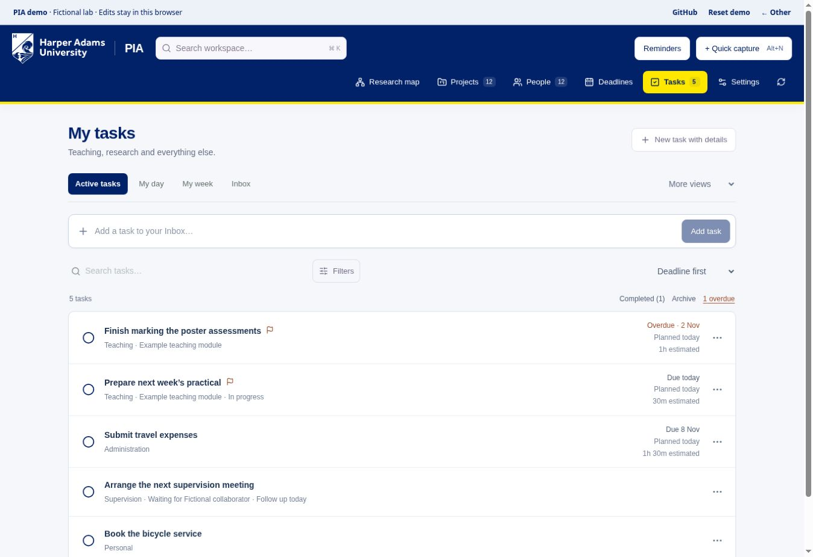

# Personal tasks and teaching planning

The **Tasks** tab tracks teaching, research, supervision, administration and personal work. A project is optional. A lecture to prepare or expenses to submit can stand alone.

On a phone or tablet, select **Menu** in the compact HAU header for workspace search, navigation, reminders and quick capture. Choosing a section closes the menu.

## Capture, organise and plan

1. Type into **Add a task to your Inbox…** in the Tasks view and press Enter or select **Add task**. **Quick capture** and **Alt+N** remain available from every section.
2. Open **Tasks → Inbox** and select the task. Add details when you are ready. **New task with details** opens the full editor directly.
3. Set **Plan to work on** to choose a working day. Set **Due date** only if there is a deadline. These dates are independent.
4. Add an effort estimate in minutes. Each task's **…** actions menu can move work to today, tomorrow or next Monday without changing the deadline. Planning removes the task from Inbox.
5. Select **Save changes**. Tick the task in the list when finished. It moves out of your active lists into **Completed**, where you can view it or untick it to reopen it.

| View | What appears |
| --- | --- |
| My day | Unfinished tasks planned for today, with estimated minutes. |
| My week | Tasks planned for the current Monday–Sunday week. Select a day or Whole week; day counts follow the active filters; the list shows total estimated effort. |
| Inbox | Unfinished tasks captured for later organisation. Clear **Keep in Inbox** in the editor, or use its **…** planning actions, to organise them. |
| Follow up | Waiting tasks whose follow-up date is today or earlier. |
| Due today / Upcoming / Overdue | Unfinished tasks whose deadlines are today / later / earlier. |
| Waiting | Tasks with status Waiting, including those without follow-up dates. |
| Active tasks | All unfinished, unarchived tasks. This is the default view. |
| Completed | Finished tasks, with their completion date, notes and checklists retained. |
| Archive | Archived tasks. Open one to read its details without restoring it. |

The default **Active tasks** view keeps the work visible immediately. **My day**, **My week** and **Inbox** are beside it; use **More views** for follow-ups, deadline views, Waiting, Completed and Archive. **Completed** and **Archive** are also directly available beside the task count. Select **Filters** for category, status, priority, project, module and academic year. A filter count and **Clear filters** stay visible when the controls are collapsed. Search combines with those filters. Tasks without a planned date remain available in Active tasks and other applicable views. Totals exclude missing estimates and describe planned effort, not time measured or available calendar capacity. Date boundaries use UK time, including daylight saving.

## Completed tasks and the archive

Completing a task automatically removes it from Active tasks, My day, My week and Inbox. It is retained in **Completed**, with its notes, checklist and completion date. Select **Completed** beside the task count, or under **More views**, to find it. Untick a completed task to reopen it and return it to Active tasks.

For longer-term storage, open the completed task's **… → Archive task** action. **Archive** lets you search and filter archived tasks, open their full details in a read-only view, and select **Restore task**. Archiving does not permanently delete the task. Restoring preserves its status: a completed task returns to Completed, and an unfinished task returns to Active tasks. Restoring does not generate a recurring successor. You can also archive an unfinished task from its editor or restore records from **Settings → Archive**.

## Teaching templates and checklists

In **New task with details → Start with a template**, choose practical preparation, teaching preparation, marking or module updates. Edit the suggested checklist to fit your work; these are starting points rather than institutional procedures. Add a **Module**, such as Insect Biology, and an **Academic year**, such as 2026/27. Neither requires a project.

Add, edit, tick or remove checklist items in the editor, then save. **Save as template** saves the task title, category, module, notes, estimated effort and an unchecked copy of its checklist. It does not save the task itself. Your template appears in the new-task menu after saving; dates, academic year and project links are chosen for each new task.

## Repeating work and follow-up

Choose **Repeat**, the interval and, optionally, **Repeat until**. A repeating task needs a due date or planned date. Completing an existing task creates one next occurrence and retains the completed one. Its checklist resets, dates move forward and the waiting-for state clears. Reopening and completing the original again does not create a second successor or remove the first. Imported completed history does not generate new tasks.

Repeats follow the original calendar date. A monthly task dated 31 January moves to the last day of February, then 31 March. Changing an occurrence's due date, or its planned date when there is no due date, starts a new cadence. A late completion advances one occurrence at a time. For irregular term dates, start from a template and set dates explicitly.

Set status **Waiting**, enter **Waiting for**, and choose a **Follow-up date** to track a reply or dependency. The Follow up view shows what needs checking. This feature does not contact anyone automatically.

## Reminders and weekly review

Open **Settings → Reminders and weekly review**. Task reminders and the weekly workload digest are separate opt-in settings; select **Save reminder settings** after changing them. Choose a UK hour, a deadline warning window from zero to seven days, and a weekly review day/time. An individual **Remind me on** date is also available in the task editor.

The deployed app checks hourly and saves alerts in **Reminders**, even while the app is closed. Each unfinished deadline, follow-up or reminder date generates one notice after its threshold. Repeated hourly checks do not duplicate it; changing the date permits a new notice. The weekly digest reports planned workload, deadlines and overdue tasks; it does not change their priorities or dates. Existing notices remain until read, including after a task is completed. The inbox displays the latest 50 notices.

Optional browser notifications use a generic message to avoid exposing task titles on screen. They require permission on that device and an open PIA page. No email, phone push, Outlook or calendar integration is included. The static demo calculates reminders only while open. You can disable reminders in Settings at any time.

## Records, backups and deployment

Tasks appear in global search and in a linked project's **Linked tasks** section. Archive a task from its editor or a completed task from its row menu. View and restore archived tasks directly in **Tasks → Archive**; **Settings → Archive** also provides restoration. Complete backups include tasks, templates and completion history: see [data and backups](data-and-backups.md).

Use the [browser setup guide](../README.md#set-up-in-your-browser). No local Node.js or Git installation is needed. This update uses the existing Cloudflare resources, with no new package dependency or external service. It adds database migration **0002_planning.sql** and an hourly reminder trigger. The normal **npm run deploy** command in Cloudflare applies the migration. Preserve existing resource bindings and secrets when updating a deployment copy.

## Assistant access

An authorised MCP assistant can read and update the same tasks and saved templates. For example:

> Add a Teaching task called “Prepare the practical”, planned for Friday, with an estimate of 90 minutes. Leave its deadline unset.

> Show waiting tasks whose follow-up date has passed.

> Use my marking template to prepare a task for this year's assessment. Ask me for the deadline if it is unknown.

The task schema includes `planned_date`, `estimated_minutes`, `module`, `academic_year`, `inbox`, `waiting_for`, `follow_up_date`, `remind_on`, `checklist` and `repeat`, alongside the existing title, category, status, priority, deadline, notes and optional project fields. Saved templates use `task_template`. Assistants must read the latest record and revision before updating it; `upsert_record` replaces submitted data rather than merging fields. Do not infer deadlines or completions without instruction or evidence.

## Validation

Automated tests cover planning separately from deadlines, UK date boundaries, recurrence and retries, checklist validation, archive integrity, owner isolation, session/CSRF checks, reminder settings and attachment recovery. Browser checks use fictional records; they do not verify a live Cloudflare account's configuration.

[Mobile task view](task-planner-mobile.jpg) · [Mobile task editor](task-editor-mobile.jpg)
